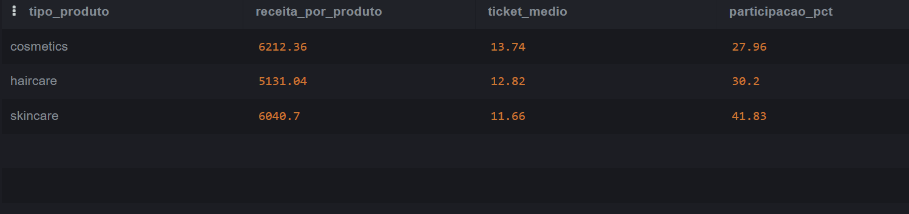
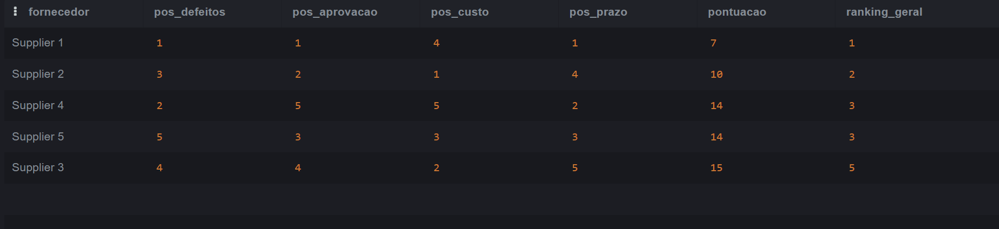
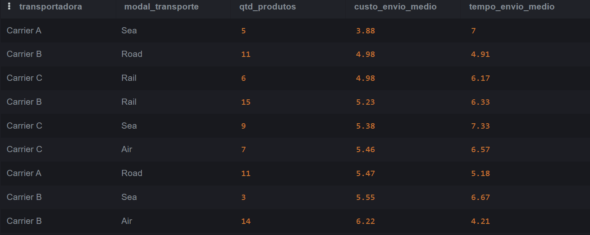

# Análise de Supply Chain com SQL

Projeto de análise de dados da cadeia de suprimentos de uma empresa de produtos de beleza. A partir de uma base com 100 produtos, respondo a 3 perguntas de negócio sobre vendas, fornecedores e logística, usando SQL.

## Objetivo

Transformar dados operacionais em respostas que apoiem decisões:

1. Quais categorias de produto são mais eficientes em receita?
2. Quais fornecedores entregam a melhor qualidade, considerando custo e prazo?
3. Quais transportadoras e modais equilibram melhor custo e prazo de entrega?

As perguntas foram escolhidas de acordo com o que a base permite responder com segurança. Temas como risco de ruptura de estoque e custo logístico por rota foram deixados de fora, porque dependeriam de colunas sem definição clara no dataset.

## Principais resultados

- **Volume não é eficiência:** o skincare lidera a receita total (41,83%), mas o cosmetics tem o maior ticket médio (13,74 por unidade) e a maior receita por produto.
- **Fornecedores:** o Supplier 1 lidera em qualidade e prazo. O Supplier 4 tem 0% de aprovação na inspeção e o maior custo de fabricação.
- **Logística:** a Carrier B é a transportadora mais barata e mais rápida. O modal aéreo custa mais e entrega mais devagar que o rodoviário.

## Ferramentas

- **SQL (SQLite)**, executado no navegador pelo [SQLite Online](https://sqliteonline.com), sem instalação.
- **IA generativa (Claude)** como apoio ao aprendizado e à revisão. Detalhes na seção [Uso de IA](#uso-de-ia).

## Estrutura do repositório

```
projeto-supply-chain/
├── data/
│   └── supply_chain_data.csv     # base original
├── sql/
│   ├── 01_exploracao.sql         # primeira leitura dos dados
│   ├── 02_limpeza.sql            # diagnóstico, limpeza e validação
│   └── 03_analises.sql           # consultas das perguntas de negócio
├── images/                       # prints dos resultados
├── dicionario_de_dados.md        # significado de cada coluna
└── README.md
```

## Os dados

- **Fonte:** [https://www.kaggle.com/datasets/harshsingh2209/supply-chain-analysis/data]
- **Tamanho:** 100 linhas (uma por produto) e 24 colunas.
- **Conteúdo:** vendas, estoque, logística, fornecedores e qualidade.
- O significado de cada coluna está no [dicionário de dados](dicionario_de_dados.md).

## Metodologia

**1. Exploração** (`01_exploracao.sql`): conferência da estrutura, das quantidades e das categorias.

**2. Diagnóstico e limpeza** (`02_limpeza.sql`):
- Verificação de duplicados, nulos, valores impossíveis e grafias diferentes. Nenhum problema encontrado.
- Criação de uma tabela limpa (`supply_chain`) com nomes em português e valores arredondados. A tabela original foi mantida intacta.
- Validação: as duas tabelas têm 100 linhas, e a receita total difere em apenas 0,04 por causa do arredondamento linha a linha.

**3. Análise** (`03_analises.sql`): consultas comentadas, uma ou mais por pergunta. Os principais resultados aparecem como imagens na seção de conclusões.

**Recursos de SQL utilizados:** agregações (`GROUP BY`, `SUM`, `AVG`, `COUNT`), filtros de grupo (`HAVING`), métricas condicionais (`CASE WHEN`), subconsultas, `UNION ALL`, CTEs (`WITH`) e funções de janela (`RANK() OVER`).

## Perguntas e conclusões

### Pergunta 1: Qual tipo de produto gera mais receita e qual tem o melhor ticket médio?



O skincare lidera a receita total, com 41,83% do faturamento, mas essa liderança vem do volume: é a categoria com mais produtos (40) e mais unidades vendidas. Já o cosmetics, apesar de ter a menor receita total (27,96%), é a categoria mais eficiente: fatura 6.212,36 por produto e tem o maior ticket médio, 13,74 por unidade vendida.

**Recomendação:** avaliar a ampliação do portfólio de cosmetics, testando novos produtos em pequena escala antes de expandir. Para o skincare, vale investigar estratégias para elevar o ticket médio, como kits e produtos premium.

### Pergunta 2: Qual fornecedor entrega a melhor qualidade?



O Supplier 1 tem o melhor desempenho geral: a menor taxa de defeitos (1,80%), a maior taxa de aprovação na inspeção (48,15%) e o menor prazo de entrega (14,78 dias). Seu custo de fabricação não é o menor, mas fica próximo da média dos demais. No ranking que combina os quatro critérios com pesos iguais, ele fica em 1º lugar, seguido pelo Supplier 2, o de menor custo.

O Supplier 4 é o principal ponto de atenção: nenhum dos seus 18 produtos foi aprovado na inspeção, 66,67% foram reprovados, e seu custo de fabricação (62,71) é o mais alto, cerca de 50% acima dos outros fornecedores. Chama atenção que sua taxa de defeitos (2,34%) seja a segunda menor, o que sugere que a inspeção avalia critérios além dos defeitos.

**Recomendação:** investigar o Supplier 4 antes de qualquer decisão, entendendo seus processos de produção e os critérios de reprovação, que os números desta base não explicam. Em paralelo, mapear as práticas do Supplier 1 para usá-las como referência na seleção de novos fornecedores.

### Pergunta 3: Qual transportadora e qual modal equilibram custo e prazo?



As três transportadoras cobram fretes praticamente iguais (entre 5,51 e 5,60, uma diferença menor que 2%), então o que as diferencia é o prazo. A Carrier B é a mais barata e também a mais rápida, com 5,30 dias, quase um dia a menos que as concorrentes. Ou seja, ela supera as outras nos dois critérios ao mesmo tempo, e já transporta 43% dos produtos.

Entre os modais, há uma troca entre custo e prazo. O marítimo tem o frete mais barato (4,97), mas é o mais lento (7,12 dias). O rodoviário é o mais rápido (4,72 dias), com custo próximo da média (5,54). O aéreo é o único modal superado nos dois critérios: é o mais caro (6,02) e ainda assim mais lento que o rodoviário (5,12 dias).

Na análise por combinação, a Carrier B com o modal rodoviário se destaca, com frete de 4,98 e prazo de 4,91 dias em 11 produtos.

**Recomendação:** adotar uma estratégia multimodal, priorizando a Carrier B no modal rodoviário para entregas com prazo curto e usando o marítimo para reposições sem urgência. Também vale revisar o uso do modal aéreo, que custa mais sem entregar mais rápido. Como a Carrier B já concentra boa parte da operação, é prudente manter as outras transportadoras como alternativa, para reduzir a dependência de um único parceiro.

## Limitações

- **Dados aparentemente sintéticos:** a receita informada não corresponde a preço × unidades vendidas. Por isso, o ticket médio foi calculado a partir da receita informada.
- **Colunas sem documentação oficial:** algumas colunas foram interpretadas a partir do nome e dos valores. As interpretações estão sinalizadas no dicionário de dados.
- **Amostra pequena:** os grupos analisados têm entre 15 e 43 produtos (e de 5 a 15 nas combinações de transportadora e modal). As diferenças indicam tendências, e não conclusões estatisticamente comprovadas.
- **Sem dimensão de tempo:** a base não tem datas, então não é possível analisar sazonalidade ou evolução.
- **Importação:** o SQLite Online cortou os nomes das colunas em 16 caracteres, o que foi corrigido na tabela limpa.

## Uso de IA

Este projeto foi desenvolvido com o apoio do Claude (Anthropic) como mentor. A IA ajudou a explicar conceitos de SQL, revisar consultas, apontar erros (como uma ordenação feita pela coluna errada, que não gerava mensagem de erro) e revisar os textos das conclusões. Parte das consultas foi escrita com assistência da IA. Todas foram executadas, conferidas e interpretadas por mim.

## Próximos passos

- Dashboard interativo no Power BI a partir da tabela limpa.
- Análise estatística em Python para testar se as diferenças entre fornecedores são significativas.

## Autor

**[Daniel Mafra]**
[LinkedIn](https://www.linkedin.com/in/daniel-mafra-82b550258/) · [E-mail](danielmafradeoliveira@gmail.com)
